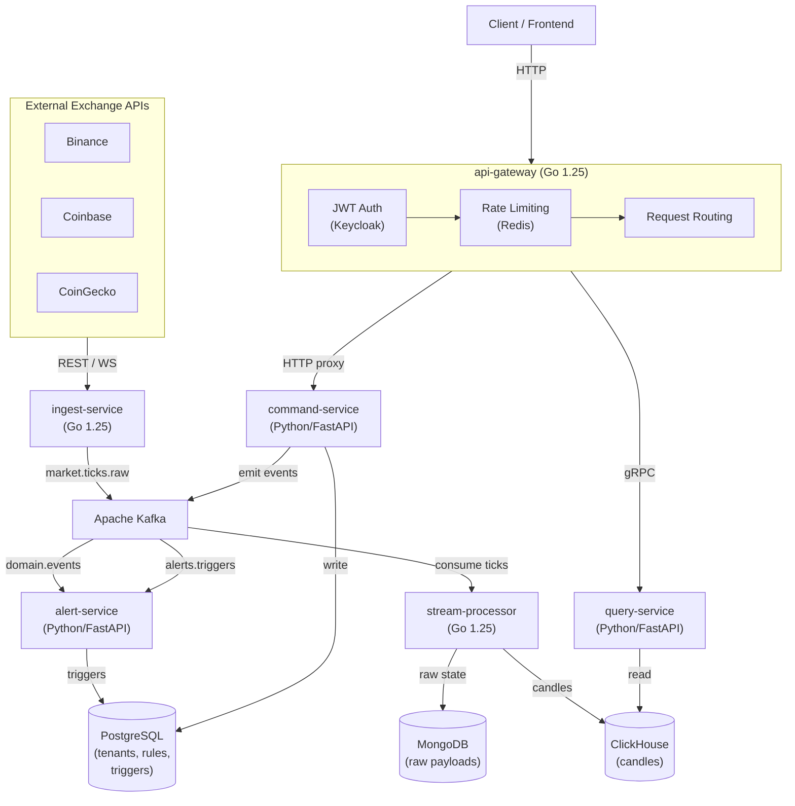
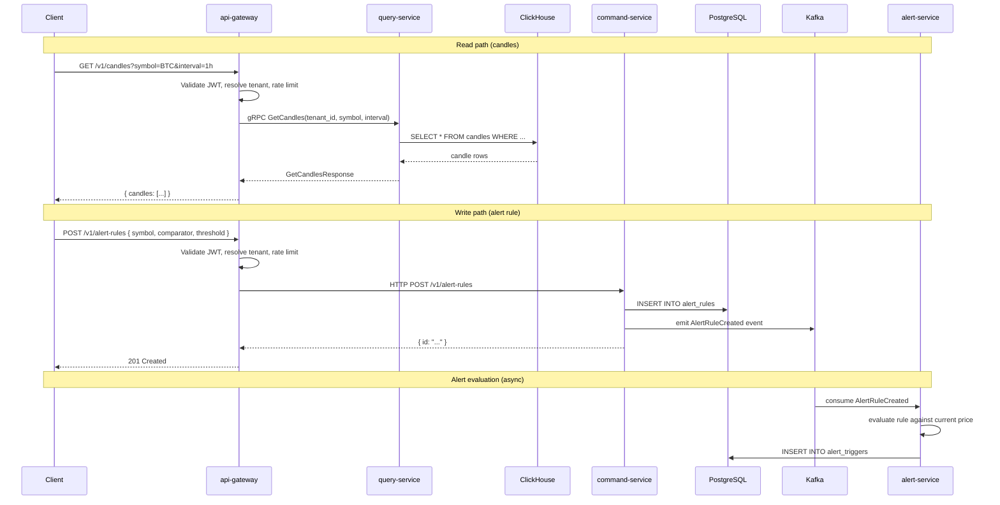
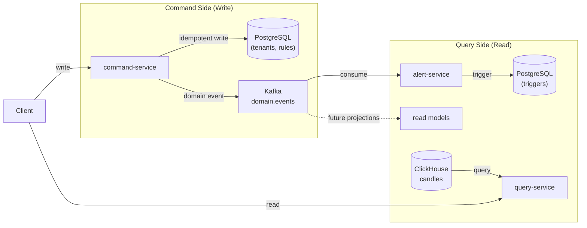
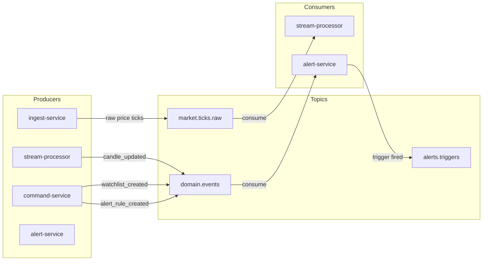

# Architecture — cryptoscope

## Overview

cryptoscope is a polyglot microservices platform for crypto market analytics. Public exchange data flows through an ingestion pipeline, is aggregated into candlesticks by a stream processor, and is served to clients through a gateway that proxies both REST queries and write commands. The read and write paths are cleanly separated using CQRS.

## System diagram

```
                    ┌──────────────────────────────────────┐
                    │         External Exchange APIs        │
                    │   Binance  ·  Coinbase  · CoinGecko   │
                    └──────────────────┬───────────────────┘
                                       │
                                       ▼
                    ┌──────────────────────────────────────┐
                    │        ingest-service (Go 1.25)       │
                    │  polls REST + WS, idempotency (Redis) │
                    └──────────────────┬───────────────────┘
                                       │ Kafka
                                       ▼
                    ┌──────────────────────────────────────┐
                    │       Apache Kafka  (Plaintext)       │
                    │   topic: market.ticks.raw              │
                    │   topic: domain.events                 │
                    │   topic: alerts.triggers               │
                    └───────┬───────────────────┬──────────┘
                            │                   │
                            ▼                   ▼
               ┌─────────────────┐   ┌─────────────────────┐
               │ stream-processor │   │    alert-service     │
               │    (Go 1.25)     │   │  (Python / FastAPI)  │
               │ ticks → candles  │   │  evaluates rules,    │
               └───┬─────────┬───┘   │  writes triggers     │
                   │         │       └────────┬────────────┘
                   ▼         ▼                ▼
          ┌────────────┐  ┌────────┐   ┌────────────┐
          │ ClickHouse  │  │ MongoDB│   │ PostgreSQL  │
          │ (candles)   │  │ (raw)  │   │ (tenants,   │
          └──────┬──────┘  └────────┘   │  rules,     │
                 │                      │  triggers)  │
                 ▼                      └──────┬──────┘
          ┌─────────────────┐                  │
          │   query-service  │                  │
          │ (Python/FastAPI) │                  │
          │  gRPC + REST     │                  │
          └────────┬─────────┘                  │
                   │                            │
                   ▼                            ▼
          ┌──────────────────────────────────────────────┐
          │              api-gateway (Go 1.25)            │
          │  HTTP → gRPC (query) · HTTP proxy (command)  │
          │  JWT auth (Keycloak) · rate limiting (Redis)  │
          │  DEV_MODE=true bypasses auth in dev            │
          └──────────────────┬───────────────────────────┘
                             │
                             ▼
               ┌─────────────────────┐
               │  command-service     │
               │ (Python / FastAPI)   │
               │  watchlists, rules   │
               │  emits domain events │
               └─────────────────────┘
```

## System diagram (Mermaid)



### Request flow



### CQRS data flow



## Services

| Service            | Language       | Port(s)         | Responsibility                                        |
| ------------------ | -------------- | --------------- | ----------------------------------------------------- |
| `ingest-service`   | Go 1.25        | 8080 (metrics)  | Polls Binance/Coinbase, publishes ticks to Kafka      |
| `stream-processor` | Go 1.25        | 8081 (metrics)  | Consumes ticks, aggregates candles → ClickHouse + Mongo |
| `api-gateway`      | Go 1.25        | 8080 (HTTP)     | Edge REST, JWT auth, tenant resolution, rate limiting |
| `query-service`    | Python 3.11    | 8001 (HTTP), 9001 (gRPC) | CQRS read side: candles, indicators, symbols  |
| `command-service`  | Python 3.11    | 8002 (HTTP)     | CQRS write side: watchlists, alert rules → Kafka events |
| `alert-service`    | Python 3.11    | 8003 (HTTP)     | Consumes events, evaluates rules, stores triggers     |

## Data stores

| Store        | Purpose                                 | Access pattern                       |
| ------------ | --------------------------------------- | ------------------------------------ |
| PostgreSQL   | Tenants, watchlists, alert rules, triggers | Async via SQLAlchemy + asyncpg       |
| ClickHouse   | OHLC candles, time-series analytics     | HTTP (query-service) + native (processor) |
| MongoDB      | Raw ingested payloads, audit archive    | Native driver (stream-processor)     |
| Redis        | Rate limiting, idempotency keys         | go-redis (Go) / redis-py (Python)   |
| Kafka        | Ticks, domain events, alert triggers    | kafka-go (Go) / aiokafka (Python)   |

## Kafka topics and event flow

The platform uses three Kafka topics to decouple services. All messages use a
JSON envelope defined in `libs/python/cryptoscope_shared/events.py` and
mirrored in the Go `CandleUpdatedEvent` struct.



### Topic details

| Topic                | Producer             | Consumer            | Message type          | Key               |
| -------------------- | -------------------- | ------------------- | --------------------- | ----------------- |
| `market.ticks.raw`   | ingest-service       | stream-processor    | `Tick` (symbol, price, volume, source, ts_millis) | symbol            |
| `domain.events`      | stream-processor, command-service | alert-service | `DomainEvent` envelope (event_type, tenant_id, data) | symbol / aggregate_id |
| `alerts.triggers`    | alert-service        | (external consumers)| trigger payload (id, rule_id, symbol, current_value) | symbol            |

### Domain event types

| event_type           | Producer           | Payload fields                                  |
| -------------------- | ------------------ | ----------------------------------------------- |
| `candle_updated`     | stream-processor   | symbol, interval, open_time_ms, OHLCV, trade_count |
| `watchlist_created`  | command-service    | id, name, symbols                               |
| `alert_rule_created` | command-service    | id, symbol, comparator, threshold               |

All events use at-least-once delivery. Producers commit after the write is
durable; consumers use idempotent processing to handle redelivery safely.

## CQRS pattern

The write and read paths are split across separate services:

- **command-service** owns all mutable state (watchlists, alert rules). Writes go to PostgreSQL and emit domain events to Kafka.
- **query-service** serves all read-only queries. Reads candles from ClickHouse and exposes indicators.
- **api-gateway** routes requests to the appropriate backend and handles cross-cutting concerns (auth, rate limiting, tenant resolution).

This split lets each side scale independently and keeps the read path free of contention from writes.

## Multi-tenancy

Every query is scoped by `tenant_id`. The gateway resolves the tenant from the Keycloak JWT claim and propagates it via gRPC metadata. In `DEV_MODE`, a default tenant is used.

```sql
-- Row-level tenant scoping
SELECT * FROM candles
WHERE tenant_id = ?
  AND symbol = 'BTC'
  AND interval = '1h'
  AND open_time > now() - INTERVAL 1 HOUR;
```

## Cross-cutting concerns

- **Observability**: OpenTelemetry traces → OTel Collector → Jaeger; Prometheus metrics → Grafana dashboards
- **Logging**: Structured JSON via `slog` (Go) and `structlog` (Python); every log line carries `service`, `tenant_id`, and `trace_id`
- **Rate limiting**: Redis token-bucket at the gateway (configurable requests/minute and burst)
- **Idempotency**: Redis-backed key checks on ingestion and command writes

## Protobuf

Service contracts are defined in `proto/cryptoscope/v1/`. Both Go and Python stubs are generated from these definitions using `make proto`. Protobuf is the source of truth for cross-service communication.

## Key design decisions

| Decision                      | Choice              | Rationale                                              |
| ----------------------------- | ------------------- | ------------------------------------------------------ |
| Ingestion language            | Go                  | High throughput, low latency for I/O-bound polling     |
| Analytics store               | ClickHouse          | Columnar store optimized for time-series aggregation   |
| Event backbone                | Kafka               | Durable, replayable, decoupled service communication  |
| Config store                  | PostgreSQL          | ACID for mutable state (tenants, rules, watchlists)   |
| Raw data archive              | MongoDB             | Flexible schema for heterogeneous API payloads        |
| Caching / rate limiting       | Redis               | Sub-millisecond latency, TTL support                   |
| Observability                 | OpenTelemetry       | Vendor-neutral instrumentation, standard protocols     |
| Frontend                      | React + Vite + Tailwind | Fast dev loop, modern tooling                     |

See `docs/adr/` for the full decision record history.
